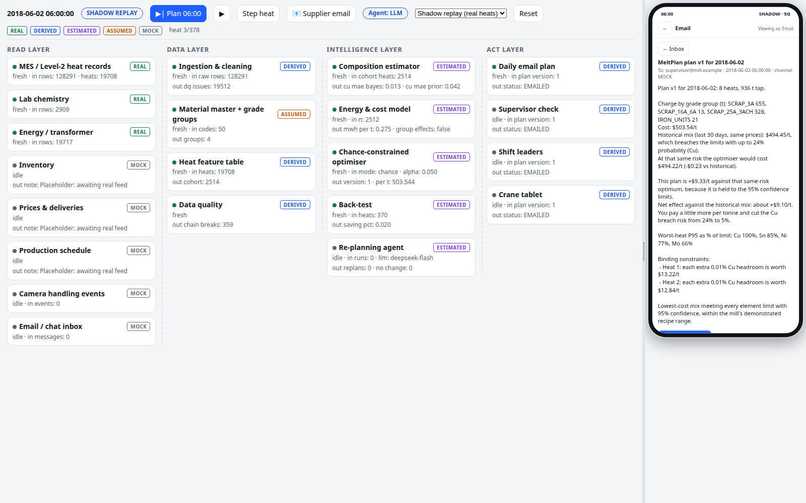

# MeltPlan

**AI scrap-mix planning for electric arc furnace steelmaking.**

<!-- Screenshot placeholder: save a capture of the two-pane UI as docs/screenshot.png -->


MeltPlan is a portfolio project about applying AI to manufacturing and heavy industry. It decides which scrap grades to charge into each furnace heat so the steel stays inside its chemistry limits at the lowest cost. It is built end to end on 20,806 real heats from a public dataset.

The app has two panes:

- **Process View**: the pipeline as four lanes, **READ → DATA → INTELLIGENCE → ACT**. Every card shows its state, inputs, outputs and data provenance, and opens an inspector with the details.
- **Phone View**: what each person at the plant sees: the **Supervisor**, the **Shift leader**, the **Crane operator**, and the daily planning **Email**.

---

## 1. The problem

An electric arc furnace (EAF) makes steel by melting scrap. Scrap is cheap, but it carries **residual elements**: copper, nickel, tin and molybdenum. The furnace cannot remove them. Whatever goes in with the scrap ends up in the steel, and every product has an upper limit on each element.

So for every heat the plant has to choose a mix of scrap grades that is:

1. **cheap**: scrap and electricity are most of the cost of a tonne of steel,
2. **safe**: the chance of going over a chemistry limit stays small,
3. **possible**: the grades are in the yard, the crane can load them, and the furnace can hold them.

Three things make this hard:

- **No one tests a scrap pile.** A pile of shredded cars and demolition steel has no certificate. The plant only measures the finished steel, after it is too late to change the mix.
- **The estimate is uncertain.** Treating a guessed copper content as exact leads to either off-spec heats or expensive over-safe mixes.
- **The shop floor changes during the day.** A pile runs out, a supplier delivery slips, a lab result comes back high, or a new scrap lot is dirtier than the last one. The morning plan stops being right.

---

## 2. What it does

| Component | What it does |
|---|---|
| **Composition estimator** | Works backwards from thousands of measured heats to estimate the Cu, Sn, Ni and Mo content of each scrap group, with an uncertainty for each. Updates after every new lab result and flags drift. |
| **Chance-constrained optimizer** | Chooses the tonnes of each group per heat to minimise material plus electricity cost, while holding each heat's probability of exceeding a chemistry limit below α (5% by default). |
| **Energy model** | Predicts electricity use per heat from the charged mix, so the cost of a mix includes the power to melt it. |
| **Re-planning agent** | An LLM agent that wakes up on lab surprises, drift alerts, shortages, rejected plans, questions and supplier emails. It runs the optimizer with different settings and explains the options. It cannot approve anything. |
| **Human-in-the-loop approval** | Every plan goes through email, supervisor approval and shift-leader release before the crane operator sees a loading list. Each role sees only what it needs. |

The design rule throughout is **the optimizer decides, the LLM operates it**. Every plan comes from the solver, every number in an agent message must come from a tool result, and every plan still needs a human to approve it.

---

## 3. Architecture


- **READ**: adapters behind typed interfaces. The MES adapter reads the real dataset. Inventory, prices, deliveries, schedule, crane camera and inbox are mocks that can be swapped for real feeds.
- **DATA**: ingest and cleaning into a DuckDB warehouse, then a feature store. Raw CSVs are never modified, and every cleaning rule is logged to a data-quality table.
- **INTELLIGENCE**: estimator, energy model, optimizer, agent and back-test. This layer reads data only through the store.
- **ACT**: plan store with a state machine and audit log, and server-side role projections. The UI only receives what its role is allowed to see.

Layers talk through typed pydantic contracts in `backend/meltplan/contracts/models.py`.

### How the pieces work

**Composition estimator.** For each heat and element, a mass balance links what was charged to what was measured:

```
measured_content × (tap + heel)  −  heel × previous_content  =  Σ_groups  tonnes_charged × group_content
```

Stacking the heats gives a regression for the unknown group contents. It is solved as non-negative least squares with priors (Bayes-NNLS), so contents cannot go negative and weakly observed groups stay near published typical values. A block bootstrap by day gives the mean, standard deviation, 90% interval and covariance. A synthetic recovery test plants a known truth in the real charge matrix and checks the method recovers it. In operation, a Kalman filter per element updates the estimates after each lab result and wakes the agent if an estimate moves more than 2σ from the batch fit.

**Optimizer.** The decision variable is the tonnes of each group in each heat. Per heat and per element the chemistry constraint is a second-order cone:

```
heel·c_heel + μᵀx + z·‖[Lᵀx, σ_ε]‖  ≤  limit · (tap + heel)
```

μ and L are the estimator's mean and Cholesky factor of the covariance, σ_ε is heat-level noise, and z matches the allowed exceedance probability α. Other constraints hold the tap weight on target, keep each group's share inside the range the plant has used, respect stock and shortages, and respect furnace capacity. The metal left in the furnace (the heel) carries over from heat to heat, and the plan iterates until that chain settles. Binding constraints are reported as plain-language shadow prices.

**Approval chain.**

```
PROPOSED → EMAILED → SUPERVISOR_APPROVED → RELEASED → LOADING → DONE
                 ↘ REJECTED          (any version can be SUPERSEDED by a newer one)
```

- The **06:00 email** summarises tonnes by group, cost compared with recent practice, worst-case risk and the top binding constraints.
- The **Supervisor** approves, rejects, picks an alternative, or hand-edits a heat in the **Mix Editor** and sees predicted chemistry, risk and cost update live.
- The **Shift leader** sees each heat's headroom as OK / AT RISK and releases the plan to the yard. No prices are shown.
- The **Crane operator** gets ordered loading lists with real material codes and grab counts. No prices are shown.

Anyone can report an issue in free text ("only 300 t of 3A left"), which goes to the agent.

**Re-planning agent.** A tool-use loop over six typed tools: `get_state`, `run_optimizer`, `evaluate_mix`, `compare_plans`, `propose_plan`, `send_message`. These guards are enforced in code, not in the prompt:

- Every number in an outgoing message must appear in a tool result. A failing message gets one rewrite.
- No prices or costs go to the crane or the shift leader.
- A candidate that loosens the spec or raises α can only be an alternative while a candidate under current settings is feasible.
- When a candidate both caps a short grade and relaxes recipe bounds, the cost change is split so a forced change is not shown as a saving.
- At most 10 tool calls and 60 seconds per run. The agent cannot approve or release a plan.

If no LLM is configured or a call fails, a deterministic policy runs the same tools under the same guards. The Process View shows which path ran, with the full trace.

---

## 4. Data

The real data is the public Kaggle dataset **"Industrial data from the arc furnace"**: **20,806 heats** in `basket_charged.csv` between 2015-01-01 and 2018-07-29, about 16 heats per day.

What profiling showed (`reports/profile.md`):

- **One grade dominates.** Material code 3A is 86.6% of all charged tonnes and appears in 20,795 of 20,806 heats. After grouping, `SCRAP_3A` is 87.1% of charged mass in the analysis cohort.
- **Final chemistry is sparse.** Only 3,709 heats have a final EAF chemistry measurement. The cohort with baskets, final chemistry and transformer data is 3,697 heats.
- **Units and formats need care.** Charged amounts are in kg (median 136,021 per heat). Transformer durations are text like `' 10: 40'`, and MW values use decimal commas.
- About 5% of heats used rare minor codes. They are removed to keep the model identifiable, which leaves 19,708 heats and an estimation cohort of 2,514 heats with chemistry and energy data. 65% of those have a measured previous-heat chemistry for the heel. The rest use a trailing median.

Material codes are mapped to four groups: `SCRAP_3A`, `SCRAP_16A_6A` (higher nickel), `SCRAP_25A_3ACH` (lower copper) and `IRON_UNITS` (pig iron and HBI, the clean dilution option).

### Provenance labels

Every value in the app carries one of four labels, shown as a badge in the UI.

| Label | What it covers |
|---|---|
| **REAL** | Heats from the Kaggle dataset: charged materials, final chemistry, transformer, gas-lance and injection data. Shadow replay uses real held-out heats. |
| **ESTIMATED** | Scrap-group contents, the energy model, the back-test result. |
| **ASSUMED** | Scrap and electricity prices, spec limits, group yields, heel mass, the code-to-group mapping, and prior contents from published typical values. All in `backend/meltplan/config/*.yaml`. |
| **MOCK** | Yard inventory, price and delivery feeds, the production schedule, crane camera events and the email channel. |

---

## 5. Results

All figures come from the generated reports in `reports/`. Metrics are on held-out heats.

### Composition estimator (`reports/estimator.md`)

Time split 70/15/15 by heat order, 2,514 heats. Test MAE in weight %:

| Element | Constant (train mean) | Bayes-NNLS | 90% interval coverage on test |
|---|---|---|---|
| Cu | 0.0144 | 0.0134 | 96% |
| Sn | 0.0010 | 0.0009 | 97% |
| Ni | 0.0149 | 0.0125 | 95% |
| Mo | 0.0057 | 0.0055 | 96% |

The estimator beats the constant-mean baseline on all four elements. The margin is small for Cu, Sn and Mo, and largest for Ni (16% lower MAE). The 90% intervals cover 95% to 97% of test heats, so they are somewhat conservative.

In the synthetic recovery test, intervals for the three scrap groups reach 75% to 100% coverage against a nominal 90%. `IRON_UNITS` fails on Cu, Ni and Mo (25% to 50%): it is 2.6% of mass, so the data barely identifies it and its estimate is mostly the prior.

### Energy model (`reports/energy.md`)

| Model | Test R² | Test MAE (MWh) |
|---|---|---|
| Total charge only | 0.338 | 1.53 |
| Per-group | 0.350 | 1.52 |

The per-group model adds 0.012 R², so it collapses to a constant 0.275 MWh per tonne for every group. On this data, energy does not separate the grades.

### Matched-risk back-test (`reports/backtest.md`)

The optimizer re-plans 370 held-out heats using estimates fitted only on the training split. It is held to **exactly the predicted residual risk the historical mix ran at**, so any saving is not bought with extra risk.

- **Result: 0.02% cheaper** at the same risk (95% bootstrap CI 0.01% to 0.03%), or $0.10 per tonne of steel.
- With ±20% random group-price perturbations (3 seeds, 150 heats each) the saving was 3.36%, 1.74% and -0.31%.

**This saving is small and depends on prices.** One grade is 87% of the mix and the plant already uses it efficiently, so the optimizer has little room to move. The prices are assumptions, and the price perturbations move the result far more than the method does. The value shown here is in the method: a risk-aware plan, an explicit uncertainty, and fast re-planning when conditions change. It is not a proven cost reduction for any real plant.

---

## 6. Running it

### Prerequisites

- Python 3.12+ and [uv](https://docs.astral.sh/uv/)
- Node.js 18+ and npm
- The Kaggle dataset "Industrial data from the arc furnace", with its CSVs in `EAF Kaggle Dataset/` at the repo root (gitignored):

```
EAF Kaggle Dataset/
├── basket_charged.csv
├── eaf_added_materials.csv
├── eaf_final_chemical_measurements.csv
├── eaf_gaslance_mat.csv
├── eaf_temp.csv
├── eaf_transformer.csv
├── ferro.csv
├── inj_mat.csv
├── ladle_tapping.csv
├── lf_added_materials.csv
└── lf_initial_chemical_measurements.csv
```

### Make targets

| Target | What it does |
|---|---|
| `make setup` | `uv sync` for the backend, `npm install` for the frontend |
| `make profile` | Profile the raw CSVs into `reports/profile.md` |
| `make data` | Ingest and clean the CSVs into the DuckDB warehouse |
| `make fit` | `data`, then fit the estimator and energy model (`reports/estimator.md`, `reports/energy.md`) |
| `make backtest` | Run the matched-risk back-test (`reports/backtest.md`) |
| `make test` | Backend pytest suite and frontend type check |
| `make api` | FastAPI backend on http://localhost:8000 |
| `make web` | Vite frontend on http://localhost:5173 |

First run:

```bash
make setup
make fit
make backtest
make api     # terminal 1
make web     # terminal 2
```

Open http://localhost:5173. The API process owns the operational database (`data/app.sqlite`).

### Optional: LLM for the agent

Without an LLM the agent uses its deterministic fallback, and the app works fully. To use an LLM, copy `backend/.env.example` to `backend/.env` and set an OpenAI-compatible endpoint:

| Variable | Meaning |
|---|---|
| `MELTPLAN_LLM_BASE_URL` | Chat-completions endpoint (default `https://integrate.api.nvidia.com/v1`) |
| `MELTPLAN_LLM_API_KEY` | API key (`NVIDIA_API_KEY` is also accepted for the default endpoint) |
| `MELTPLAN_LLM_MODEL` | Model name (default `z-ai/glm-5.3`) |
| `MELTPLAN_LLM_EXTRA_BODY` | Optional JSON merged into each request |
| `MELTPLAN_LLM=off` | Always use the deterministic fallback |

Tests never call an LLM.

### Demo scenarios

**Daily plan**
1. Click **Plan 06:00**. The optimizer builds the next 24 hours and the plan is emailed.
2. On the phone, open **Email** → **Open in MeltPlan**, then **Approve**, or **Edit** to open the Mix Editor.
3. Switch to **Shift leader** → **Release**.
4. Switch to **Crane**, work through the loading list with **GRAB DONE**, then **Basket complete**.
5. Click **Step heat** (or ▶) to tap heats. Lab results arrive and the estimator updates.

**When conditions change**
- **Supplier email**: a supplier announces a 3A shortage the current recipe cannot absorb. The agent explores options and proposes a plan with costed alternatives.
- **Report an issue** from the Shift leader or Crane screen, for example "Only 300 t of 3A left".
- **Reject** a plan as the Supervisor and the agent re-plans.
- **Simulated drift scenario**: a copper-heavy scrap lot raises lab copper, the Kalman filter flags drift, and the agent proposes a safer mix.

Click any Process View card to inspect raw MES rows, the estimator fit, the optimizer solution and shadow prices, the agent trace, the back-test, the data-quality log and the audit trail.

### API

| Method | Route | Purpose |
|---|---|---|
| GET | `/api/state` | Full Process View state |
| GET | `/api/phone/{role}` | Role projection (`email`, `supervisor`, `shift_leader`, `crane`) |
| GET | `/api/events` | Server-Sent Events stream |
| GET | `/api/groups` | Scrap groups and metadata |
| POST | `/api/sim/reset`, `/api/sim/step_heat`, `/api/sim/plan`, `/api/sim/inbox` | Simulation control and the supplier-email scenario |
| POST | `/api/plan/evaluate`, `/api/plan/edit` | Mix Editor: what-if evaluation and saving a hand-edited version |
| POST | `/api/plan/approve`, `/api/plan/reject`, `/api/plan/release` | Approval chain |
| POST | `/api/crane/grab_done`, `/api/crane/basket_complete` | Crane loading events |
| POST | `/api/report/shortage`, `/api/report/issue` | Free-text issues for the agent |
| POST | `/api/chat`, `/api/email/read` | Questions to the agent, email read receipts |

### Project structure

```
backend/meltplan/
  config/          grade map, mill parameters, prices, spec classes (YAML)
  contracts/       pydantic contracts between layers
  read/            adapter protocols, Kaggle MES adapter, mock adapters
  data/            profiling, ingest and cleaning, feature store
  intelligence/    estimator/, optimizer/, agent/, energy.py, backtest.py
  act/             plan store and state machine, role projections, email
  sim/             simulation world, Process View state, scenarios
  api/             FastAPI app and SSE
backend/tests/     pytest suite
frontend/src/      process/, phone/, components/, store/, api/
reports/           generated reports
data/              generated artefacts (gitignored databases)
```

---

## 7. Tech stack

| Area | Tools |
|---|---|
| Data | DuckDB, pandas, NumPy |
| Modelling | SciPy, scikit-learn, cvxpy with the Clarabel solver |
| Backend | FastAPI, Uvicorn, pydantic, SQLite, Server-Sent Events |
| Agent | Any OpenAI-compatible chat-completions endpoint, with a deterministic fallback |
| Frontend | React 18, TypeScript, Vite, Zustand, Recharts, react-resizable-panels |
| Tooling | uv, npm, pytest, Make |

---

## 8. Limitations and next steps

**Limitations**
- Prices, spec limits, yields and heel mass are assumptions. Inventory, deliveries, camera events and email are mocked. The numbers show how the method behaves, not findings about a real plant.
- The dataset is dominated by one grade, so minor groups are weakly identified and `IRON_UNITS` is close to its prior.
- Only 3,709 of 20,806 heats have final chemistry, which limits the estimation cohort.
- The energy target (sum of MW over transformer rows) is a provisional definition.
- The default spec class is set tighter than a typical rebar spec so that the copper limit binds and the explanations have something to show.
- The agent's numbers and role visibility are checked in code. The wording of its messages is not.

**Next steps**
- Run on a dataset with a more varied scrap mix, where the optimizer has room to move.
- Replace the mock adapters with real yard inventory and price feeds.
- Add a scrap-delivery inspection signal (camera or handheld XRF) as a prior update.
- Extend the back-test with real price history instead of assumed prices.
- Broaden the end-to-end test coverage of the phone screens.
