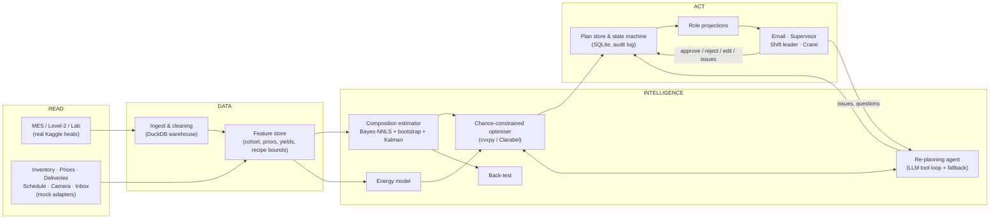

# Mini-ScrapChef

**A scrap-mix optimiser for electric arc furnace (EAF) steelmaking, built end to end on real furnace data.**

Mini-ScrapChef plans which scrap grades to charge into each heat so that the steel stays inside its chemistry limits (copper, tin, nickel, molybdenum) at the lowest cost. It pairs a statistical model of what is in each scrap pile with a chance-constrained optimiser, sends the plan through a human approval chain, and uses an LLM agent to re-plan when something changes on the shop floor.

The app has two panes side by side:

- **Process View**: the whole pipeline as four lanes, **READ → DATA → INTELLIGENCE → ACT**. Every card shows its state, inputs, outputs and where its data comes from, and opens an inspector with the details.
- **Phone View**: what each person at the plant sees on their phone: the **Supervisor**, the **Shift leader**, the **Crane operator**, and the daily planning **Email**.

> Mini-ScrapChef is an independent learning and demo project. It is inspired by publicly described commercial scrap-optimisation products, but it is not affiliated with, endorsed by, or based on the code of any of them.

---

## Why this problem

An EAF melts scrap steel. Scrap is cheap, but it carries **residual elements**, mostly copper, that cannot be removed in the furnace. Each product has an upper limit on these elements. The plant therefore has to choose a mix of scrap grades for every heat that is:

1. cheap enough (scrap and electricity are most of the cost of a tonne of steel),
2. safe enough (the chance of going over a chemistry limit stays small), and
3. possible (the grades are in the yard, the crane can load them, the furnace can hold them).

The difficulty is that **nobody measures what is in a scrap pile**. The plant only measures the finished steel. Mini-ScrapChef works backwards from thousands of measured heats to estimate each grade's content, carries the uncertainty of that estimate into the optimiser, and keeps learning from every new lab result.

---

## Architecture



Each layer talks to the next through typed contracts (`backend/scrapchef/contracts/models.py`). The intelligence code reads data only through the store, and the UI only receives role projections built on the server.

---

## Features

**Planning and optimisation**
- Chance-constrained blend optimiser (second-order cone program): each heat's probability of exceeding a chemistry limit is held below α (5% by default).
- Daily 06:00 plan for the next 24 hours, split into baskets and into the plant's real material codes, with crane grab counts.
- Heel carry-over: the metal left in the furnace from one heat feeds the next, and the plan iterates until that chain settles.
- Explainability: binding constraints are turned into plain-language shadow prices ("what an extra 0.01% of copper headroom is worth per tonne").
- Comparison with the plant's own recent practice at the **same predicted risk**, so a saving is never bought with extra risk.

**Learning from data**
- Composition estimator for Cu, Sn, Ni and Mo per scrap group (Bayesian non-negative least squares on a mass balance).
- Uncertainty from a day-block bootstrap, used directly by the optimiser.
- Online Kalman filter that updates the estimates after every lab result and raises a drift alert when a scrap source changes.
- Energy model fitted on transformer data, and a back-test on held-out heats.

**Human-in-the-loop operations**
- Plan state machine with an audit log: proposed → emailed → supervisor approved → released → loading → done.
- Role-based views built on the server, so each role only receives what it is allowed to see (the crane and shift leader never see prices).
- Supervisor **Control Suite**: hand-edit a heat with sliders and see the predicted chemistry, risk, cost and effect on later heats live before saving a new version.
- Crane loading lists with grab-by-grab confirmation, basket completion and "plan changed" alerts.

**Re-planning agent**
- An LLM agent that wakes up on lab surprises, chemistry breaches, drift alerts, shortage reports, rejected plans, questions and supplier emails.
- **The optimiser decides, the LLM operates it**: the agent chooses settings, explores options and explains them, but every plan comes from the solver and every plan still needs human approval.
- Safety guards enforced in code, not in the prompt (see [below](#4-re-planning-agent)).
- Fully deterministic fallback when no LLM is configured or a call fails.

**Simulation**
- **Shadow replay** of real held-out heats against the live estimates.
- **Simulated drift scenario**: a copper-heavy scrap lot arrives and the system has to notice and react.
- **Supplier email scenario**: a supplier announces a shortage and the agent has to work out costed alternatives.
- Live updates to every screen over Server-Sent Events.

---

## How it works

### 1. Composition estimator

For each measured heat and each element, a mass balance links what was charged to what was measured:

```
measured_content × (tap + heel)  −  heel × previous_content  =  Σ_groups  tonnes_charged × group_content
```

Stacking thousands of heats gives a regression for the unknown group contents. It is solved as a **non-negative least squares with priors** (Bayes-NNLS), so contents can never go negative and weakly observed groups stay near published typical values. A **block bootstrap by day** gives a mean, a standard deviation, a 90% interval and the covariance between groups. Validation uses a 70/15/15 time split and a **synthetic recovery test** (plant a known truth in the real charge matrix and check the method recovers it).

During operation, a **Kalman filter** per element updates the estimates after every lab result. If an online estimate drifts more than 2σ from the batch estimate, the agent is woken up.

### 2. Optimiser

The decision variable is the tonnes of each scrap group in each heat. The objective is material cost plus electricity cost per tonne of steel. The main constraint, per heat and per element, is a second-order cone:

```
heel·c_heel + μᵀx + z·‖[Lᵀx, σ_ε]‖  ≤  limit · (tap + heel)
```

where μ and L come from the estimator (mean and Cholesky factor of the covariance), σ_ε is the heat-level model noise, and z matches the allowed exceedance probability α. Further constraints keep the tap weight on target, keep each group's share within the range the plant has actually used, respect yard stock and reported shortages, and respect furnace capacity. Simpler `aim` and `margin` modes (plain LPs) are also available for comparison.

The solution is turned into a **plan version**: per heat, per basket, per real material code, with predicted P50/P95 chemistry, exceedance probability, cost per tonne and the binding constraints with their shadow prices.

### 3. Approval chain

```
PROPOSED → EMAILED → SUPERVISOR_APPROVED → RELEASED → LOADING → DONE
                 ↘ REJECTED          (any version can be SUPERSEDED by a newer one)
```

- The **06:00 email** summarises the plan: tonnes by group, cost compared with recent practice, worst-case risk and the top binding constraints.
- The **Supervisor** approves, rejects, picks an alternative or hand-edits a heat in the Control Suite.
- The **Shift leader** sees each heat's headroom as OK / AT RISK, predicted versus measured copper, and releases the plan to the yard.
- The **Crane operator** sees ordered loading lists with real material codes and grab counts, and confirms grabs and baskets.

Anyone can report an issue in free text ("only 300 t of 3A left", "the 3ACh pile is empty"), which goes to the agent.

### 4. Re-planning agent

The agent is a tool-use loop over a small, strictly typed toolset:

| Tool | Purpose |
|---|---|
| `get_state` | Current plan, open heats, estimates, stock, recent events |
| `run_optimizer` | Solve a candidate plan with chosen settings (caps, exclusions, spec class, α, relaxed bounds) |
| `evaluate_mix` | Predict chemistry, risk and cost for a given mix without solving |
| `compare_plans` | Compare candidates against the live plan |
| `propose_plan` | Publish a new version (with up to two alternatives) for supervisor approval |
| `send_message` | Send a note to a role |

Guards are enforced in code, whatever the model writes:

- **Numbers must be real.** Every number in an outgoing message must appear in a tool result (as given or rounded). A failing answer gets one rewrite naming the problem.
- **Role visibility.** No prices, costs or currency amounts go to the crane or the shift leader.
- **Least-relaxed proposal.** A candidate that loosens the spec or raises α can only be an alternative while a candidate under the current settings is feasible. Alternatives with the same cost are dropped.
- **No silent unsafe plans.** After a lab result or drift, a live plan above the risk limit with no feasible candidate gets a reminder, then the fallback takes over.
- **Must act.** Shortages, supplier emails and rejections must end in a proposal or a clear answer.
- **Bounded runs.** Anti-churn thresholds, at most 10 tool calls and 60 seconds per run. The agent cannot approve or release anything.
- **Cost splits.** When a candidate both adds a shortage cap and relaxes recipe bounds, the cost change is split into "caused by the shortage" and "caused by relaxing the recipe", so a forced change is never presented as a plain saving.

If no LLM is configured or a call fails, a deterministic policy (`policy.py`) runs the same tools under the same guards. The Process View shows which path ran for every agent run, with its full trace.

### 5. Energy model and back-test

- **Energy:** a Huber regression of MWh per heat on the charged tonnes per group. On this dataset the per-group effects add almost nothing over total charge, so the model collapses to a constant MWh per tonne.
- **Back-test** (`reports/backtest.md`): on 370 held-out heats, the optimiser re-plans each heat with estimates fitted only on earlier data. For a fair comparison, it is held to **exactly the risk the historical mix actually ran at**. Under the assumed prices the optimiser is about **0.02% cheaper** at matched risk (95% CI 0.01–0.03%). The plant's mix is dominated by a single grade, which leaves the optimiser little room. With ±20% price noise the saving ranges from about −0.3% to +3.4%. The result depends on prices far more than on the method.

---

## Data: what is real and what is assumed

Every value in the app carries a provenance label, and the UI shows it as a badge.

| Label | What it covers |
|---|---|
| **REAL** | Heats from the public Kaggle dataset *Industrial data from the arc furnace*: charged materials by mill code, final chemistry, transformer, gas-lance and injection data. Shadow replay uses real held-out heats. |
| **ESTIMATED** | Scrap-group contents (Cu, Sn, Ni, Mo), the energy model, the back-test result. |
| **ASSUMED** | Scrap and electricity prices, spec limits, group yields, heel mass, the code-to-group mapping, and the prior contents taken from published typical values. All of these live in `backend/scrapchef/config/*.yaml`. |
| **MOCK** | Yard inventory, price and delivery feeds, the production schedule, crane camera events and the email channel. They sit behind typed adapter interfaces, ready to be swapped for real feeds. |

Things worth knowing about the data:

- The plant's material codes are grouped into **four scrap groups**: `SCRAP_3A` (about 87% of all charged mass), `SCRAP_16A_6A` (higher nickel), `SCRAP_25A_3ACH` (lower copper) and `IRON_UNITS` (pig iron / HBI, the clean dilution lever).
- About 5% of heats used rare minor codes. They are removed to keep the model identifiable, which leaves 19,708 heats and an analysis cohort of 2,514 heats with chemistry and energy data. The raw CSVs are never modified, and every cleaning rule is logged in a data-quality table.
- Because one grade dominates, the minor groups are only weakly identified, and the iron-units contents are essentially their prior.
- The default spec class (`plant_strict`) is deliberately tighter than a typical rebar spec, so that the copper limit binds and the explanations have something to show.

---

## Getting started

### Prerequisites

- Python **3.12+** and [uv](https://docs.astral.sh/uv/)
- Node.js **18+** and npm
- The Kaggle dataset **"Industrial data from the arc furnace"**

### 1. Get the data

Download the dataset from Kaggle and put the CSV files in a folder called `EAF Kaggle Dataset/` at the repository root:

```
EAF Kaggle Dataset/
├── basket_charged.csv
├── eaf_added_materials.csv
├── eaf_final_chemical_measurements.csv
├── eaf_gaslance_mat.csv
├── eaf_temp.csv
├── eaf_transformer.csv
├── ferro.csv
├── inj_mat.csv
├── ladle_tapping.csv
├── lf_added_materials.csv
└── lf_initial_chemical_measurements.csv
```

The folder is gitignored.

### 2. Install, build the warehouse and fit the models (once)

```bash
make setup      # uv sync (backend) + npm install (frontend)
make fit        # ingest CSVs → DuckDB warehouse, fit the estimator and the energy model
make backtest   # run the held-out back-test
```

`make fit` and `make backtest` write Markdown reports to `reports/` (`estimator.md`, `energy.md`, `backtest.md`) and the fitted models to `data/`.

Optional: `make profile` writes a data-profiling report of the raw CSVs to `reports/profile.md`.

### 3. Run

In two terminals:

```bash
make api        # FastAPI backend on http://localhost:8000
make web        # Vite frontend on http://localhost:5173
```

Open **http://localhost:5173**. The agent runs in fallback mode until you [configure an LLM](#configuring-the-llm-agent).

> The API process is the single owner of the operational database (`data/app.sqlite`). Scripts or notebooks that create a simulation `World` get a private in-memory store instead.

---

## Demo walkthrough

**The daily plan**
1. Click **Plan 06:00** in the top bar. The optimiser builds the next 24 hours and the plan is emailed.
2. On the phone, open **Email** → **Open in ScrapChef**. Read the summary, ask a question, then **Approve** (or try **Edit** to open the Control Suite).
3. Switch to **Shift leader** → **Release**.
4. Switch to **Crane** → work through the loading list with **GRAB DONE**, then **Basket complete**.
5. Click **Step heat** (or ▶) to tap heats. Lab results arrive, the estimator updates and the Process View follows along.

**When things go wrong**
- **📧 Supplier email**: a supplier announces a 3A shortage that the current recipe cannot absorb. Watch the agent explore options and propose a plan with costed alternatives for the supervisor.
- **Report an issue** from the Shift leader or Crane screen in free text, e.g. *"Only 300 t of 3A left"* or *"The 3ACh pile is empty"*.
- **Reject** a plan as the Supervisor and the agent re-plans.
- Switch the mode selector to **Simulated drift scenario** and press ▶. A copper-heavy scrap lot raises lab copper, and the agent notices the surprise and proposes a safer mix.

Click any card in the Process View to open its inspector: raw MES rows, estimator fit, optimiser solution and shadow prices, the agent's step-by-step trace, back-test, data-quality log and the audit trail.

---

## Configuring the LLM agent

The agent works with any **OpenAI-compatible** chat-completions endpoint. Put the settings in `backend/.env` (gitignored) or in the environment:

```bash
SCRAPCHEF_LLM_BASE_URL=https://api.deepseek.com
SCRAPCHEF_LLM_API_KEY=sk-...
SCRAPCHEF_LLM_MODEL=deepseek-flash
```

| Variable | Meaning |
|---|---|
| `SCRAPCHEF_LLM_BASE_URL` | Endpoint (default: NVIDIA's OpenAI-compatible API) |
| `SCRAPCHEF_LLM_API_KEY` | API key (`NVIDIA_API_KEY` is also accepted for the default endpoint) |
| `SCRAPCHEF_LLM_MODEL` | Model name (default: `z-ai/glm-5.3`) |
| `SCRAPCHEF_LLM_EXTRA_BODY` | Optional JSON merged into each request, e.g. `{"reasoning_effort":"low"}` for reasoning models |
| `SCRAPCHEF_LLM=off` | Disable the LLM and always use the deterministic fallback |

The agent chip in the top bar shows **LLM**, **fallback** or **working**. Tests never call an LLM.

---

## API

The backend is a FastAPI app (`backend/scrapchef/api/main.py`).

| Method | Route | Purpose |
|---|---|---|
| GET | `/api/state` | Full Process View state |
| GET | `/api/phone/{role}` | Role projection (`email`, `supervisor`, `shift_leader`, `crane`) |
| GET | `/api/events` | Server-Sent Events stream (resumable) |
| GET | `/api/groups` | Scrap groups and their metadata |
| POST | `/api/sim/reset`, `/api/sim/step_heat`, `/api/sim/plan`, `/api/sim/inbox` | Simulation control and the supplier-email scenario |
| POST | `/api/plan/evaluate`, `/api/plan/edit` | Control Suite: what-if evaluation and saving a hand-edited version |
| POST | `/api/plan/approve`, `/api/plan/reject`, `/api/plan/release` | Approval chain |
| POST | `/api/crane/grab_done`, `/api/crane/basket_complete` | Crane loading events |
| POST | `/api/report/shortage`, `/api/report/issue` | Free-text issues for the agent |
| POST | `/api/chat`, `/api/email/read` | Questions to the agent, email read receipts |

---

## Project structure

```
.
├── Makefile
├── backend/                      Python 3.12, managed with uv
│   ├── scrapchef/
│   │   ├── config/               grade map, mill parameters, prices, spec classes (YAML)
│   │   ├── contracts/            pydantic contracts between layers
│   │   ├── read/                 adapter protocols, the Kaggle MES adapter, mock adapters
│   │   ├── data/                 profiling, ingest/cleaning, feature store
│   │   ├── intelligence/
│   │   │   ├── estimator/        mass balance, Bayes-NNLS, bootstrap, Kalman, validation
│   │   │   ├── optimizer/        chance-constrained model, mix evaluation, plan builder
│   │   │   ├── agent/            LLM loop, tools, guards, fallback policy, triggers, narrator
│   │   │   ├── energy.py
│   │   │   └── backtest.py
│   │   ├── act/                  plan store & state machine, role projections, email rendering
│   │   ├── sim/                  simulation world, Process View state, scenarios
│   │   └── api/                  FastAPI app + SSE
│   └── tests/
├── frontend/                     React 18 + TypeScript + Vite
│   └── src/
│       ├── process/              Process View lanes and inspector drawers
│       ├── phone/                Email, Supervisor, Shift leader, Crane screens
│       ├── components/           shared widgets (headroom bars, badges, agent panel)
│       ├── store/                Zustand store synced over SSE
│       └── api/                  typed API client
├── data/                         generated artefacts (estimates, energy model, back-test)
└── reports/                      generated reports (data profile, estimator, energy, back-test)
```

---

## Testing

```bash
make test       # backend pytest suite + frontend type-check
```

The backend suite covers:
- **Optimiser:** feasibility, tap target, monotonic cost under tighter limits, Monte Carlo exceedance ≤ α, agreement between `evaluate_mix` and the plan, and a sanity check that a solver frozen to the historical mix reproduces its cost.
- **System:** role visibility, the plan state machine and the event round trip.
- **Agent:** triggers, guards and the fallback policy. These run with `SCRAPCHEF_LLM=off`, so they are deterministic.
- **Regressions:** one test for each issue found in end-to-end testing.

---

## Tech stack

| Area | Tools |
|---|---|
| Data | DuckDB, pandas, NumPy |
| Modelling | SciPy, scikit-learn, cvxpy (Clarabel solver) |
| Backend | FastAPI, Uvicorn, pydantic, SQLite, Server-Sent Events |
| Agent | OpenAI-compatible client (DeepSeek, GLM via NVIDIA, or any compatible endpoint) |
| Frontend | React 18, TypeScript, Vite, Zustand, Recharts, react-resizable-panels |
| Tooling | uv, npm, pytest, Make |

---

## Project status

🚧 **Mini-ScrapChef is still in development.**

The full pipeline works end to end: data ingestion, estimation, optimisation, the approval chain, the role-based phone views, the re-planning agent and the simulation scenarios. It is a **demonstrator, not a production system**:

- Prices, spec limits and several plant parameters are assumptions, and inventory, deliveries, camera events and email are mocked. The numbers show how the method works. They are not findings about any real plant.
- The LLM agent's messages are checked for correct numbers and role visibility, but their wording is not fully verified yet.
- UX polish, more scenarios and a broader test suite are still in progress, and known issues are being worked through.

Feedback, issues and suggestions are welcome.
